# MobileNetV2 and MobileViT-XXS on the ESP32-S3

Code, experiment records, and figures accompanying **Evaluating Lightweight Neural Architectures under INT8 Quantization for Resource-Constrained Edge AI** (ICAART 2027).

The study compares MobileNetV2, a convolutional neural network, with MobileViT-XXS, a hybrid convolutional-transformer model, from fine-tuning through INT8 quantization and execution on an ESP32-S3. It evaluates classification accuracy, model size, inference time, and tensor-arena memory usage.

MobileNetV2 retained 97.22% accuracy in full INT8 and required 3.27 seconds per inference. MobileViT-XXS collapsed after full INT8 quantization; structural channel grouping recovered an exploratory 96.30%, but inference required 46.28 seconds. The smaller model needed about 14 times as long per inference on the evaluated device.

The nine figures from the paper are reproduced below. The sections below link to the records behind the results, including per-class metrics, individual predictions, configuration comparisons, and device telemetry.

## Dataset and experimental protocol

Butterflies-Austria-20 contains 6,479 images in 20 classes, divided into 5,183 training, 648 validation, and 648 test images. Both models use the same stratified partitions with seed 42 and ImageNet-pretrained weights. All model parameters were fine-tuned using AdamW and a One-Cycle schedule.

Model-specific preprocessing was preserved: MobileNetV2 uses 224 × 224 RGB inputs with ImageNet normalization; MobileViT-XXS uses 256 × 256 BGR inputs in [0,1]. The comparison therefore covers each pretrained pipeline with its own preprocessing.

**Paper Figure - Examples from the shared partitions.**

| Training | Test | Validation |
|---|---|---|
|  |  |  |

**Paper Figure - Training class distribution.**

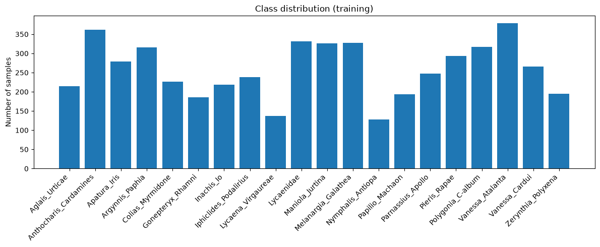

Dataset images are available separately from the publisher. [Dataset documentation](data/README.md) covers the source reference, exact partition manifests, class mapping, calibration membership, and image checksums.

## Floating-point baselines

| PyTorch model | Parameters | Test accuracy | Macro F1 |
|---|---:|---:|---:|
| MobileNetV2 | 2,249,492 | 97.07% | 97.00% |
| MobileViT-XXS | 957,444 | 97.22% | 97.21% |

Both models reached their best validation accuracy at epoch 26 and stopped at epoch 34. The PyTorch test accuracies differ by one image, and MobileViT-XXS has approximately 57.4% fewer parameters.

**Paper Figure 3: Training and validation curves.**

| MobileNetV2 | MobileViT-XXS |
|---|---|
| 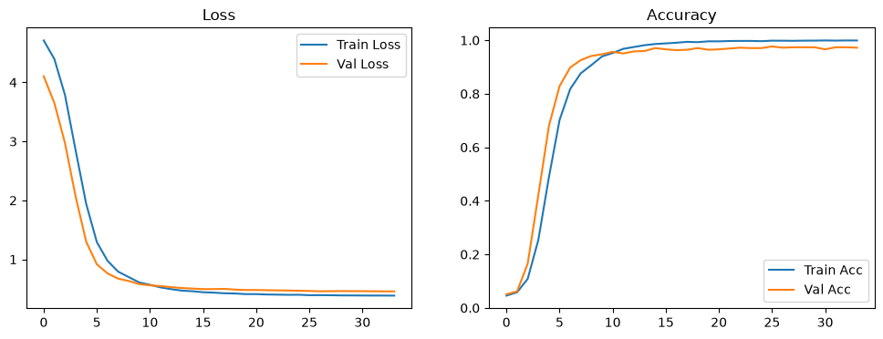 | 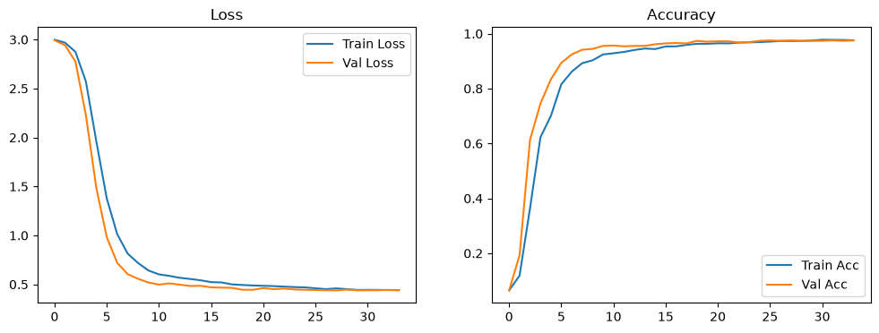 |

**Paper Figure 4: Test predictions. Green titles indicate correct predictions; red titles indicate errors.**

| MobileNetV2 | MobileViT-XXS |
|---|---|
|  |  |

**Paper Figure 5: PyTorch test confusion matrices.**

| MobileNetV2 | MobileViT-XXS |
|---|---|
| 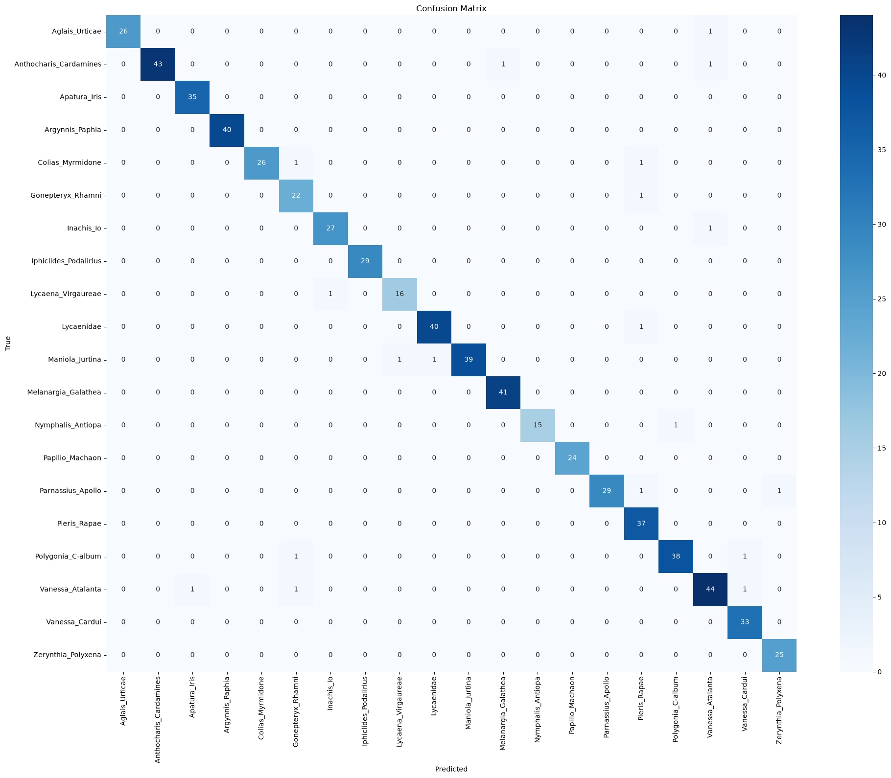 | 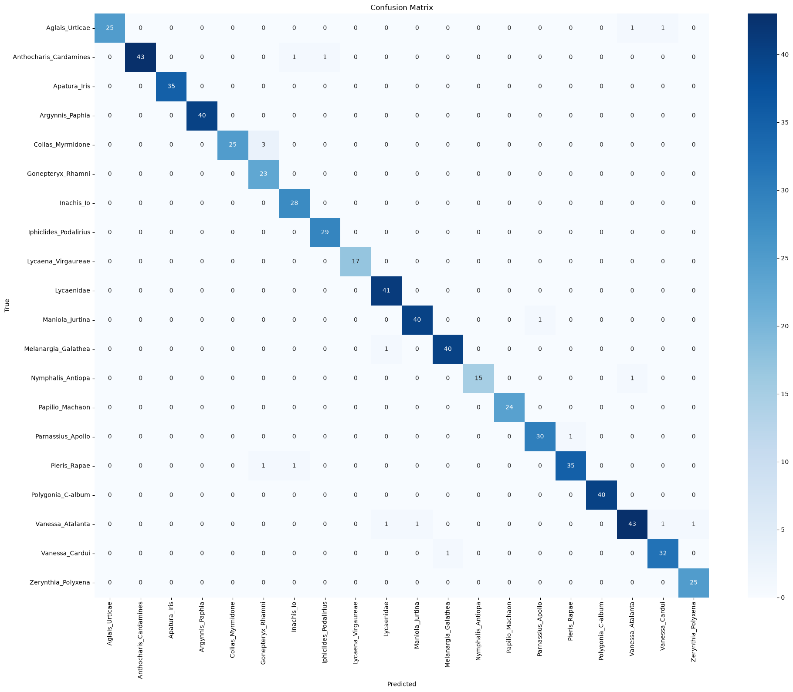 |

Records: [MobileNetV2 training and classification report](results/training/mobilenetv2/recorded_outputs.json) · [MobileViT-XXS training and classification report](results/training/mobilevit_xxs/recorded_outputs.json).

## Initial TFLite conversion and quantization

Models were converted from PyTorch to TFLite using LiteRT and evaluated as FP32, INT8A16 (INT8 weights and INT16 activations), and full INT8 (INT8 weights and activations). The initial calibration used 100 training samples per model.

| TFLite representation | MobileNetV2 test accuracy | MobileViT-XXS test accuracy |
|---|---:|---:|
| FP32 | 97.07% | 97.38% |
| INT8A16 | 97.22% | 96.76% |
| Initial full INT8 | 97.22% | 9.57% |

MobileNetV2 remained stable, while MobileViT-XXS degraded when activations were reduced to INT8. A separate ungrouped MobileViT-XXS control used 1,000 stratified training samples and deployment-oriented export adaptations. It reached 10.65%. The control is distinct from the initial conversion, which reached 9.57%.

Records: [Initial MobileNetV2 conversion](results/quantization/initial/mobilenetv2/recorded_outputs.json) · [Initial MobileViT-XXS conversion](results/quantization/initial/mobilevit_xxs/recorded_outputs.json) · [Ungrouped and grouped controls](results/quantization/mobilevit_g8_4_4/results.csv).

## Activation diagnosis

When one activation scale is shared, channels with small ranges can end up with few representable levels if other channels have much larger ranges. FP32 diagnostics found a maximum-to-minimum channel-scale ratio of approximately 874× in block 2. Block 3 had a median of six estimated effective levels, with 85.4% of channels using at most 16 levels.

**Paper Figure 6: Activation-scale heterogeneity and estimated effective INT8 levels.**

| Scale heterogeneity | Estimated numerical resolution |
|---|---|
| 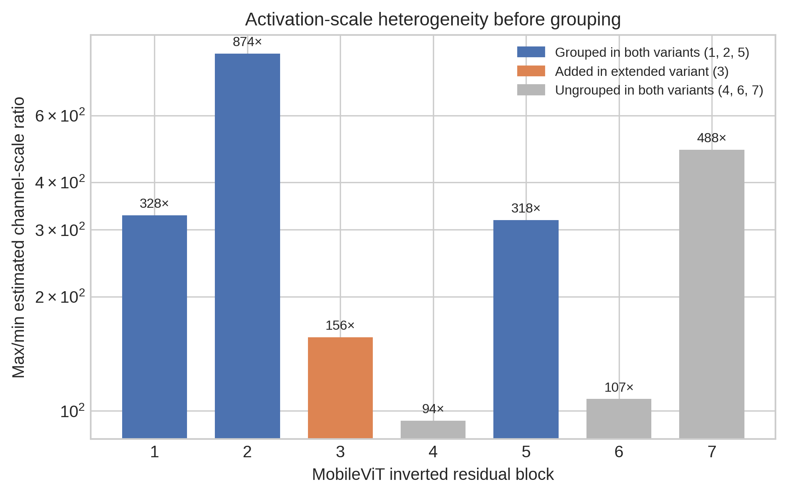 | 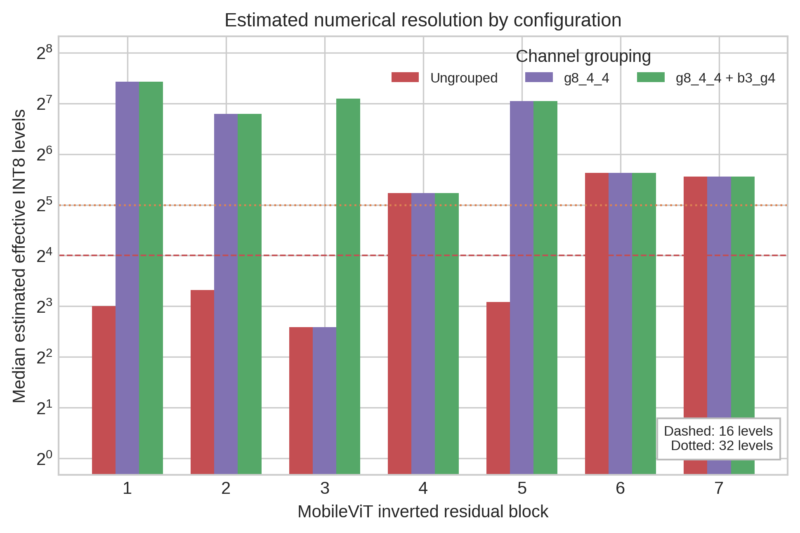 |

The estimates come from PyTorch FP32 activations; they are not direct measurements of the scales stored in TFLite. They support an association with the collapse; they do not establish a unique causal mechanism.

**Paper Figure 7: Complementary weight diagnostics.**

| Expansion-weight distributions | Weight and activation relationship |
|---|---|
| 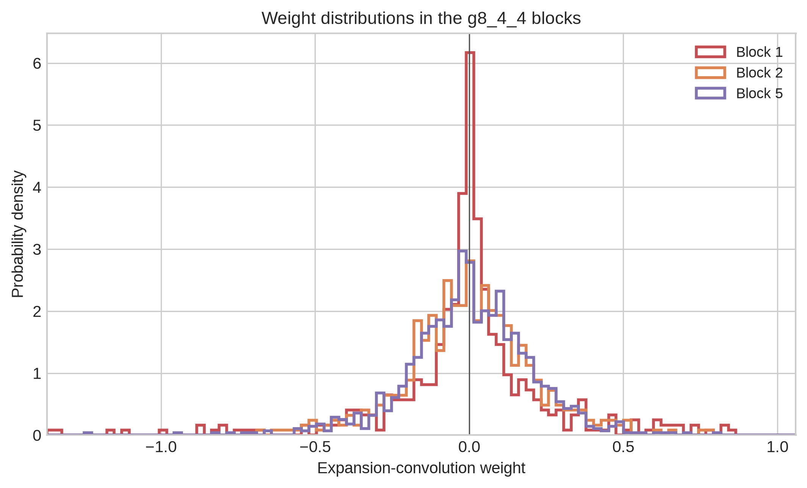 | 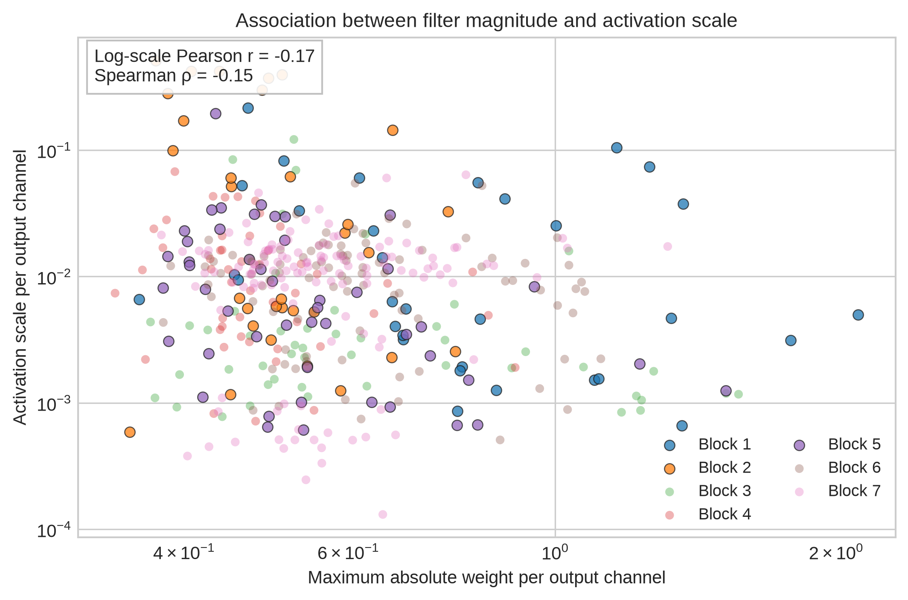 |

The weak association between weight magnitude and activation scale indicates that filter magnitude alone does not explain the observed behavior. The [diagnostic tables](results/diagnostics/) include block summaries, per-channel estimates, grouping statistics, and weight and activation correlations.

## Structural channel grouping and recovery

Channels are ordered by their observed activation ranges and partitioned into groups, each implemented as a separate branch. A block here is a convolutional `MobileViTInvertedResidual` module. The branches retain the corresponding expansion, depthwise, and projection parameters. Their outputs are summed, the projection bias is distributed across branches, and the residual connection is applied once. Separate activation tensors allow the quantizer to assign independent scales. No retraining or quantization-aware training was used.

Seventeen configurations were compared with the same checkpoint, stratified calibration set, quantizer, and validation partition. The initial `g8_4_4` configuration groups blocks 1, 2, and 5 into 8, 4, and 4 groups. The selected extension adds four groups in block 3.

| MobileViT-XXS INT8 configuration | Validation accuracy | LiteRT test accuracy |
|---|---:|---:|
| Ungrouped control | 10.80% | 10.65% |
| `g8_4_4` | 89.66% | 90.74% |
| `g8_4_4 + b3_g4` | **95.52%** | **96.30%** |

**Paper Figure 8: Recovery of INT8 accuracy.**

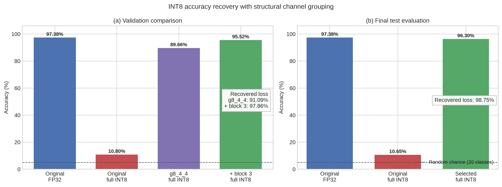

"Original full INT8" in the plot denotes the ungrouped 1,000-sample control. The test panel shows the selected configuration. The `g8_4_4` test result was obtained separately for the paired analysis.

The selected configuration classified 624 of 648 test images correctly and recovered 98.75% of the accuracy loss between its FP32 reference and the ungrouped INT8 control. Selection used validation accuracy. The test partition had been examined before the final evaluation, so recovery remains exploratory. Neither more groups nor larger scale ratios consistently improved accuracy; `g8_4_4` ranked fifth on validation.

Records: [All 17 configurations](results/structural_comparison/ablation_summary.csv) · [Selection rule](results/structural_comparison/selection.json) · [Per-variant records](results/structural_comparison/variants/) · [Selected-model test report](results/structural_comparison/selected_int8_test_report.json).

## Paired statistical analysis

Five TFLite models were evaluated on the same 648 test images in the same order. The analysis reports Wilson accuracy intervals, paired-bootstrap intervals for accuracy differences, and two-sided exact McNemar tests with Holm correction across seven comparisons.

**Paper Figure 9: Paired accuracy differences.**

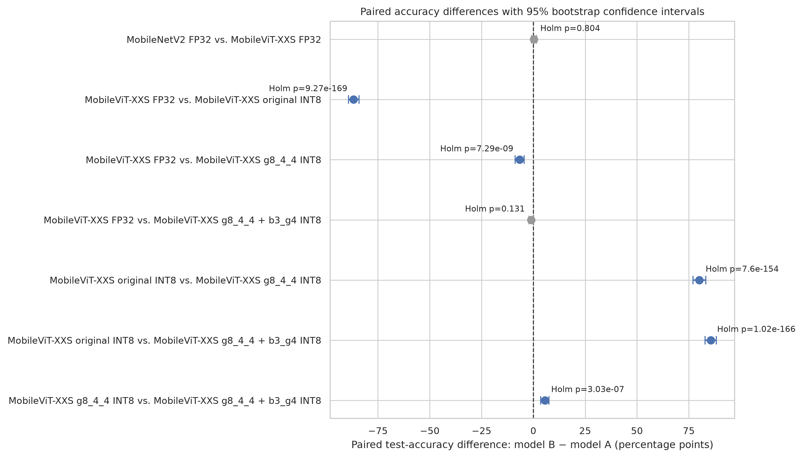

The accuracy gains over the ungrouped control and `g8_4_4` remained statistically significant after Holm adjustment. The comparison between the selected configuration and MobileViT-XXS FP32 was not significant after adjustment (p = 0.131), which does not demonstrate equivalence. Bootstrap intervals in the figure are marginal and unadjusted; Holm applies to the McNemar p-values. These analyses do not remove the exploratory nature of the recovery result.

Records: [Per-image predictions](results/statistical_analysis/tables/paired_test_predictions.csv) · [McNemar, bootstrap, and Holm results](results/statistical_analysis/tables/mcnemar_results.csv) · [statsmodels verification](results/statistical_analysis/tables/statsmodels_mcnemar_results.csv).

## ESP32-S3 execution

The three INT8 artifacts were evaluated on an ESP32-S3 DevKitC-1 N16R8 at 240 MHz, using TensorFlow Lite Micro and compatible ESP-NN kernels. The host preprocessed and quantized each image, then sent its input tensor to the microcontroller.

| Deployed INT8 model | Test accuracy | Mean inference ± SD | Model size (bytes) | Arena used (bytes) |
|---|---:|---:|---:|---:|
| MobileNetV2 | **97.22%** | **3.270 ± 0.002 s** | 2,809,720 | 2,599,136 |
| MobileViT-XXS, `g8_4_4` | 91.05% | 45.657 ± 0.033 s | 1,843,720 | 2,881,824 |
| MobileViT-XXS, `g8_4_4 + b3_g4` | 96.30% | 46.284 ± 0.034 s | 1,868,496 | 2,885,136 |

**Timing covers model invocation only.** Acquisition, preprocessing, communication, input copying, and postprocessing are excluded. Arena use is measured against 5,242,880 reserved bytes and is not total firmware RAM. LiteRT and device predictions are reported separately; for example, `g8_4_4` achieved 90.74% on the host and 91.05% on the device.

Adding block 3 increased device accuracy by 5.25 percentage points with a 1.37% increase in mean inference time. However, the recovered MobileViT-XXS still required about 14 times as long per inference as MobileNetV2. The pipelines differ in input resolution, operator composition, and ESP-NN coverage. The latency difference cannot be attributed to a single architectural factor without profiling. Energy and end-to-end application latency were not measured.

The [device-results guide](results/esp32s3/README.md) links the three runs, including individual predictions, timing distributions, memory statistics, classification reports, and deployed-model hashes.

## Repository guide

| Material | Location |
|---|---|
| Dataset reference, partition and calibration manifests | [data/](data/README.md) |
| Fine-tuning, conversion, grouping, statistics, and plotting notebooks | [notebooks/](notebooks/README.md) |
| Trained checkpoints, TFLite artifacts, and model identities | [models/](models/README.md) |
| Full empirical records and interpretation of fields and units | [results/](results/README.md) |
| Paper figures and supplementary visualizations | [figures/](figures/README.md) |

The recorded software versions are PyTorch 2.10.0+cu128, LiteRT-Torch 0.9.4, AI Edge Quantizer 0.9.0, AI Edge LiteRT 2.2.0, ESP-IDF 5.5.0, and ESP-NN v1.1.2. The notebooks document model-specific execution requirements. Results and figures can be inspected directly without running training or inference.
