# Empirical figures

These are existing experiment figures copied into a categorized layout. They were not regenerated, edited, or recomputed. PNG files can be viewed below; PDF versions are included where they existed in the source directories.

[catalog.csv](catalog.csv) maps every PNG to its related notebook/script and result records. [provenance.csv](provenance.csv) records every copied PNG/PDF, its original workspace path, current path, byte size, and SHA-256. Renamed files retain the original image bytes and labels.

## Dataset and baseline examples

The same physical training, validation, and test partitions were used for both models. Each pipeline retains its own preprocessing. Corresponding MobileViT-XXS examples are available in [dataset/mobilevit_xxs/](dataset/mobilevit_xxs/).

| Training class distribution | Training examples |
|---|---|
| 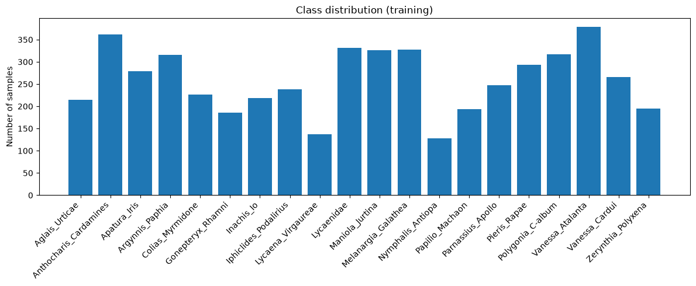 |  |

| Test examples | Validation examples |
|---|---|
|  |  |

Data and generator: the [baseline notebooks](../notebooks/README.md) and [saved training outputs](../results/training/).

## PyTorch training and test results

| MobileNetV2 | MobileViT-XXS |
|---|---|
| 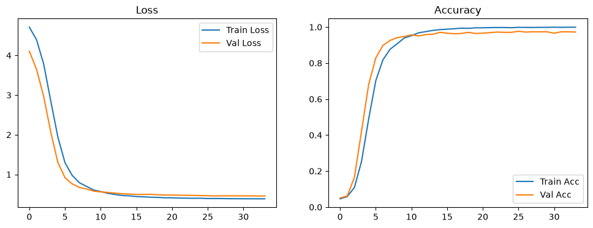 | 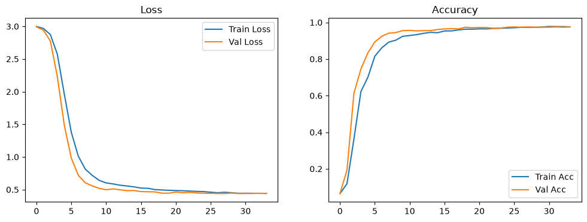 |
|  |  |
| 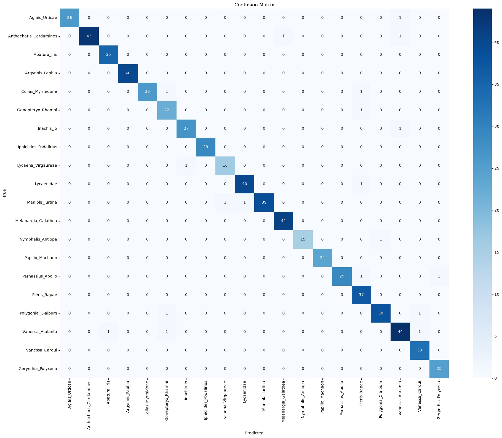 | 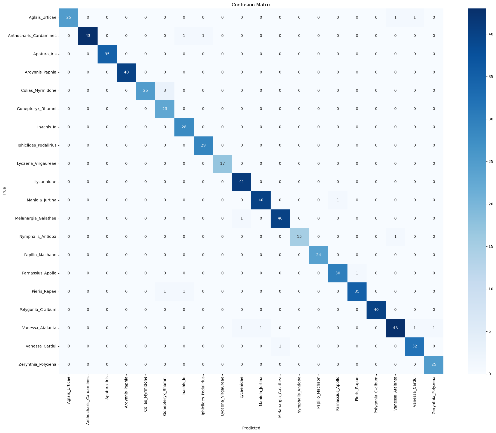 |

These are the baseline notebook figures; they are separate from the device confusion matrices below. Classification-report text and training logs are retained in [results/training/](../results/training/).

## INT8 diagnosis and recovery

| Activation-scale heterogeneity | Estimated effective INT8 levels |
|---|---|
| 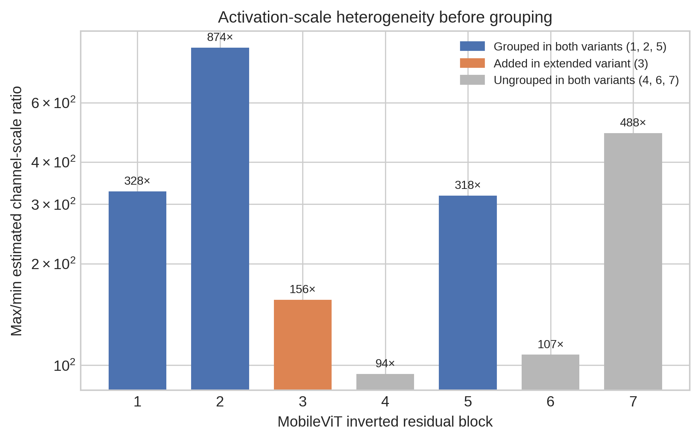 | 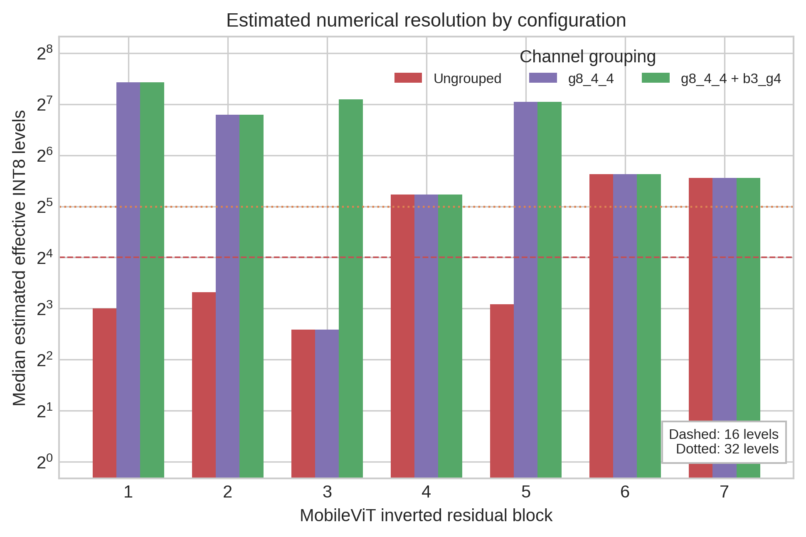 |

The first panel compares the largest and smallest diagnostic channel scales per block. The second compares median effective quantization levels under the ungrouped and grouped representations. These quantities are estimated from FP32 PyTorch activations; they are not direct TFLite tensor-scale measurements. Lines at 16 and 32 levels are descriptive references.

Saved data: [block_activation_summary.csv](../results/diagnostics/block_activation_summary.csv), [estimated_effective_levels_summary.csv](../results/diagnostics/estimated_effective_levels_summary.csv), and [per-channel estimates](../results/diagnostics/estimated_effective_levels_by_channel.csv). Related script: [regenerate_activation_scale_diagnosis.py](../notebooks/05_figures/regenerate_activation_scale_diagnosis.py).

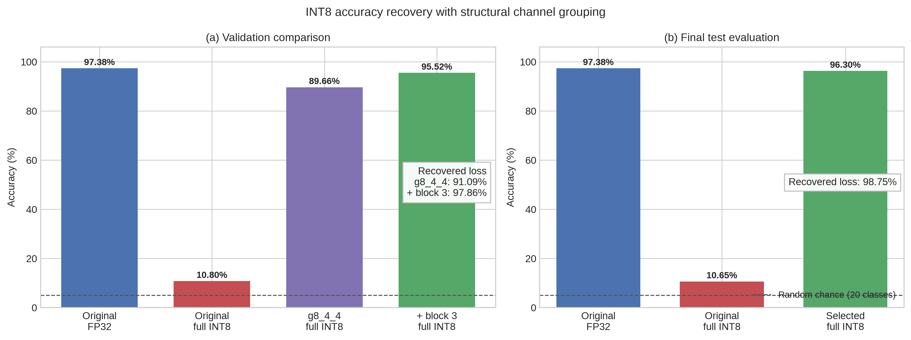

[PDF](quantization/int8_accuracy_recovery_comparison.pdf) · [Plot data](../results/diagnostics/accuracy_recovery_comparison.csv)

The control labeled `Original full INT8` is the stratified, ungrouped MobileViT-XXS INT8 control, not the initial 100-image INT8 conversion. The plot's test panel follows the selected-configuration evaluation; the later paired analysis also evaluated `g8_4_4` on test. Those records are available separately in [model_accuracy.csv](../results/statistical_analysis/tables/model_accuracy.csv). Recovery remains exploratory.

| Weight distributions | Weight--activation relationship |
|---|---|
| 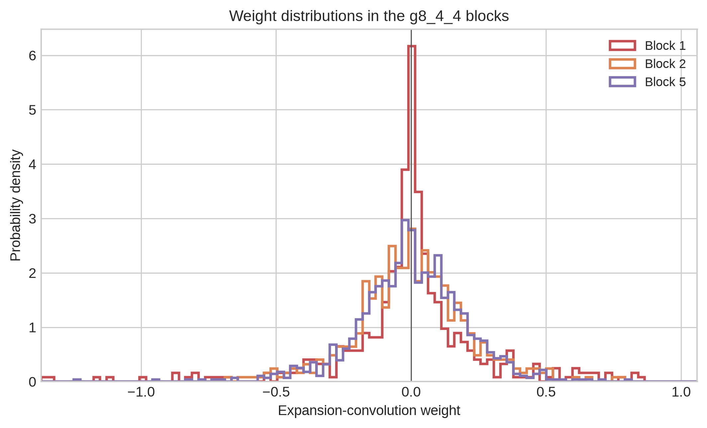 | 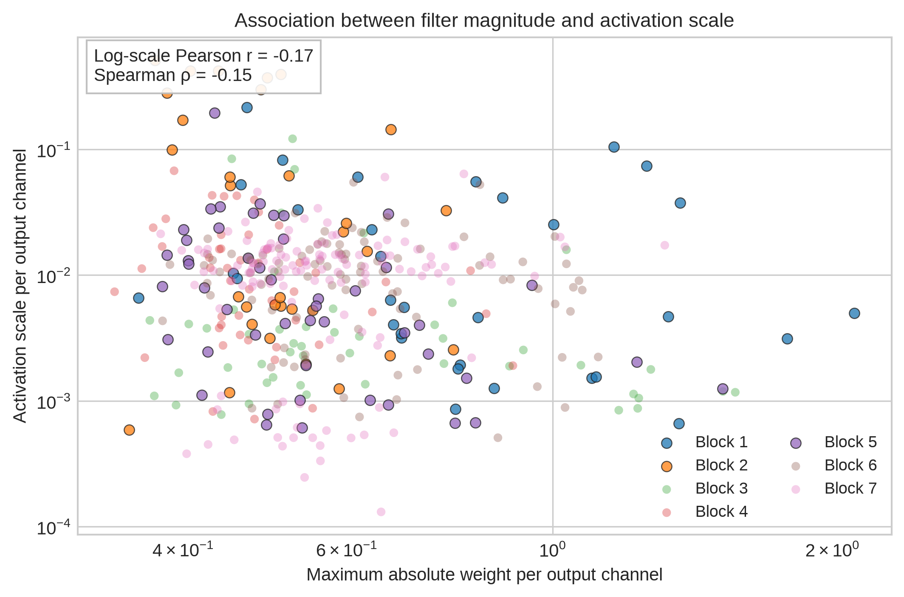 |

Related data: [expansion-weight statistics](../results/diagnostics/expansion_weight_channel_statistics.csv) and [weight--activation correlations](../results/diagnostics/weight_activation_correlations_by_block.csv). The latter describes association, not causality.

Additional diagnostic PNG/PDF files in [quantization/](quantization/) retain scale ratios, channel-level utilization, low-resolution channel fractions, group partitions for blocks 1/2/5, the combined diagnosis panel, and the earlier grouping-only recovery figure. Historical labels such as `codes` refer to quantization levels, not memory or image counts. The initial-grouping plot and the selected-configuration comparison represent different stages and should not be merged as if they were a single evaluation.

## Structural configuration comparison

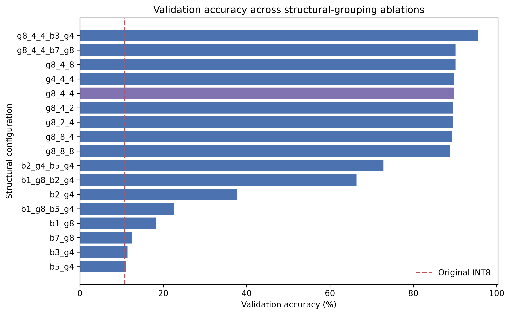

| Accuracy and model size | Controlled contrasts |
|---|---|
| 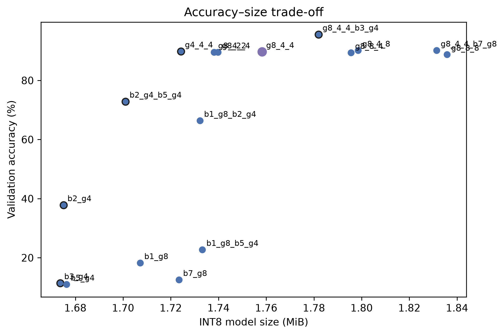 | 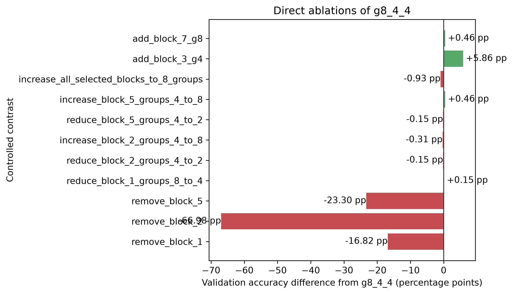 |

Data: [17-configuration validation summary](../results/structural_comparison/ablation_summary.csv), [controlled contrasts](../results/structural_comparison/g8_4_4_contrasts.csv), and [selection record](../results/structural_comparison/selection.json). Notebook: [structural comparison](../notebooks/03_structural_comparison/mobilevit_xxs_structural_comparison.ipynb).

The earlier block-7 extension has its own [records](../results/block7_extension/) and [incremental comparison figure](quantization/block7_incremental_accuracy_delta.png). It is kept separate from the 17-configuration run.

## Paired statistical analysis

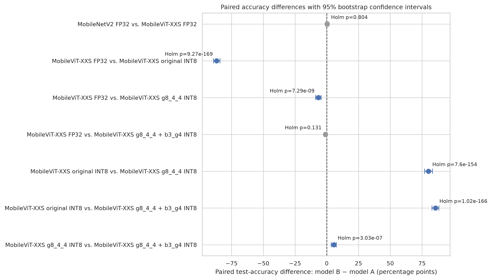

Bars show marginal, multiplicity-unadjusted bootstrap intervals; Holm adjustment applies to the McNemar p-values. Nonsignificance does not demonstrate equivalence, and the test partition's prior use limits confirmatory interpretation.

Further figures in [statistical_analysis/](statistical_analysis/) show accuracy intervals, discordant pairs, contingency tables, and adjusted p-values. Data: [paired predictions](../results/statistical_analysis/tables/paired_test_predictions.csv), [McNemar results](../results/statistical_analysis/tables/mcnemar_results.csv), and [statsmodels results](../results/statistical_analysis/tables/statsmodels_mcnemar_results.csv). Notebook: [paired analysis](../notebooks/04_statistical_analysis/paired_statistical_analysis.ipynb).

## ESP32-S3 predictions

| MobileNetV2 INT8 | MobileViT-XXS INT8 with `g8_4_4` | MobileViT-XXS INT8 with `g8_4_4 + b3_g4` |
|---|---|---|
| 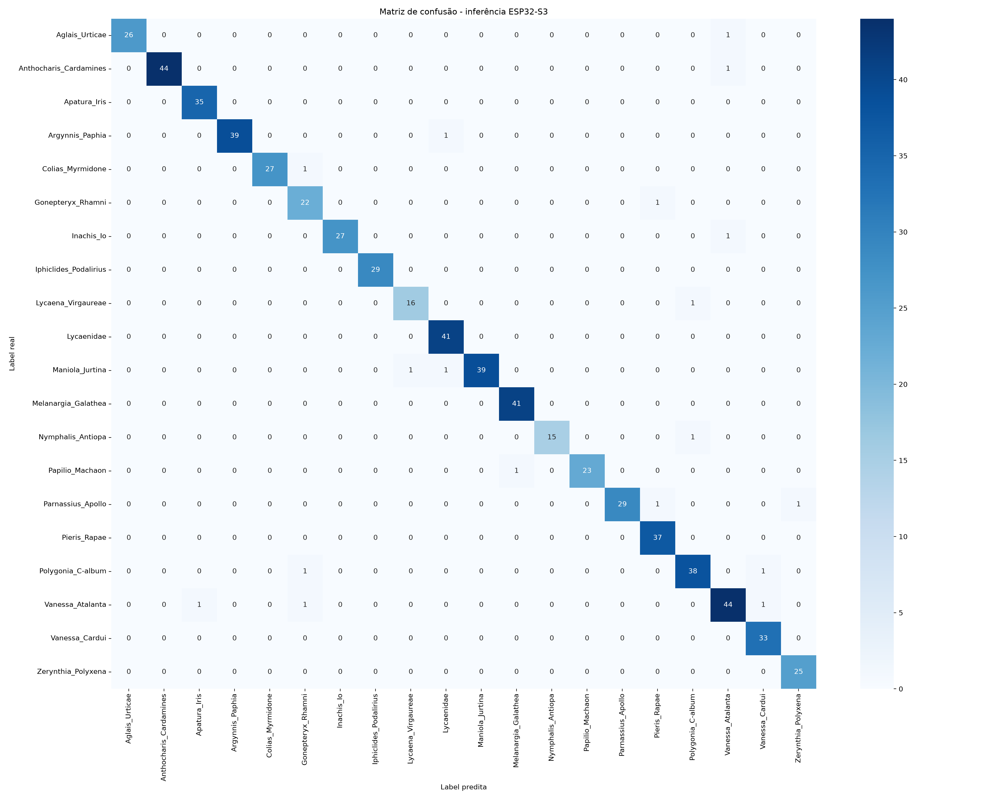 |  | 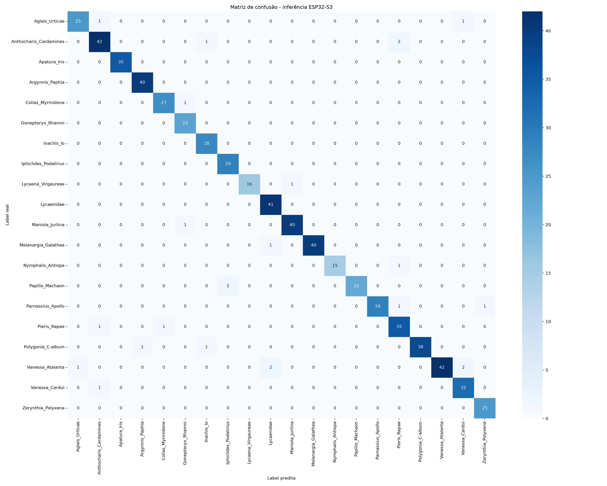 |

These confusion matrices use predictions returned by the microcontroller. Raw predictions, invocation-time distributions, memory statistics, and deployed model hashes are linked in the [device-results guide](../results/esp32s3/README.md). No new latency or memory plot was generated in this stage.
